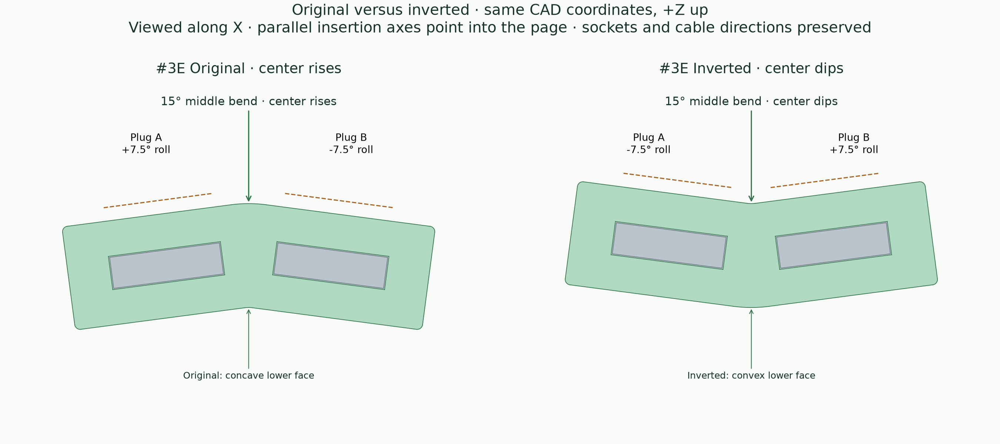

# Compact USB-C cable retainers

**Winning design: #3 compact press-fit.** The user selected #3 as the preferred design from the compact v2 models.

Revision 2 contains three separate, one-piece cable holders, retaining the IDs from the original nine-part plate:

| Left to right on the new plate | Mechanism | Revision |
| --- | --- | --- |
| **#3** | Axial press-fit | Original snug socket and mouth widths/heights; shortened throat and housing capture; relief slots retained. |
| **#5** | Side-entry | Stepped lateral access for the housing and metal tip; rounded housing detents; slide inward 0.8 mm to retain the tip behind the side wall. |
| **#9** | Ribbed push-in | Two opposing pairs of rounded vertical ribs in each housing pocket; they grip the plastic housing and grow from the floor without floating roof ribs. |

All bodies are **24 × 17 × 8.4 mm**, about 45% shorter than the original #3. Both metal tips remain inward-facing and enclosed; only the front **3.2 mm** of each plastic housing is captured. Most of each housing stays exposed. These holders do not assemble together.

The oval designs and other alternatives are no longer generated. Original exports remain in `generated/` for reference; compact output defaults to `generated/v2/`.

## Curved #3B variation

**#3B 15° curved press-fit** follows the wrist with two straight sockets tilted **7.5° each**, joined by a smooth, tangent center arc. Its finished dimensions are **24 × 17 × 9.777 mm**: the overall length and width match #3, while the bend increases overall height. The local body thickness remains **8.4 mm**.

The winning #3 socket and mouth dimensions, nominal 0.8 mm throat, 0.8 mm relief slots, 10.8 mm pocket depth, and 3.2 mm housing capture are preserved in each socket's local frame. The finished centerline radius is **6.075 mm**, with **1.201 mm minimum separation** between the pockets. Exterior end corners use a 0.8 mm radius so the enclosed relief-slot walls retain at least **0.8 mm** of material. The original straight #3 and all v2 exports are preserved.

Wear #3B with the **concave underside toward the wrist**. Push each plug straight along its own tilted socket axis toward the center. Pull outward along that same axis to remove it.

Generate the variation and its A1 project:

```bash
uv run python main.py --variant curved-press-fit
uv run python build_plate.py --variant curved-press-fit
```

This mode defaults to **`generated/v3/`**; `--output-dir` overrides it. Existing `--skip-stl`, `--skip-step`, and `--bambu-studio` options retain their behavior on their respective commands. Running without `--variant` still generates the original v2 plate.

The [A1 print project](generated/v3/curved_press_fit_3B_A1_PLA.3mf) contains one centered #3B using Generic PLA, a 0.4 mm nozzle, 0.20 mm Standard layers, and Textured PEI. It is oriented **on its flat long side**, making the original 17 mm width the print height. Supports are disabled. Open the project in Bambu Studio and click **Slice plate**.

The [CAD preview and side section](generated/v3/preview.png) show the straight socket axes and total bend. [Layer-path images](generated/v3/layer_paths.png), `toolpath_review.json`, and `validation.json` record the native slice and bridge checks. Physical acceptance still requires testing with the cable: retain #3's usable fit, improve wrist seating, and show no cracking or separation at the center during insertion.

## Side-by-side #3C variation

**#3C Side-by-side press-fit** is a flat **13 × 30 × 8.4 mm** holder with two parallel sockets **13 mm apart**, centered at ±6.5 mm across its width. One plug enters from each end, with the plugs' wide faces parallel to the top and the cables exiting opposite ends. Each plug has its own blind pocket.

Each socket reuses #3's geometry through translation: **8.65 × 2.95 mm** metal pocket, **12.20 × 6.60 mm** housing pocket, **11.25 × 5.65 mm** mouth, nominal **0.8 mm throat** with the existing transition overlap, and **0.8 mm relief slots**. Pocket depth remains **10.8 mm** and housing capture **3.2 mm**. The closed end walls are **2.2 mm** thick. The closest separation between the lanes' cavities and relief slots is **1.044 mm**, and enclosed relief-slot walls retain at least **0.8 mm**. Exterior corner radii are 0.8 mm with 0.4 mm edge fillets.

| Design | Body dimensions | Socket arrangement |
| --- | --- | --- |
| Winning #3 | 24 × 17 × 8.4 mm | Two aligned sockets entered from opposite ends. |
| Curved #3B | 24 × 17 × 9.777 mm | Two straight sockets tilted 7.5° each around a curved center. |
| Side-by-side #3C | 13 × 30 × 8.4 mm | Two parallel, offset sockets entered from opposite ends. |
| Curved side-by-side #3D | 15.2 × 30 × 9.774 mm | Two offset sockets tilted 7.5° each, with concave wrist and convex outer faces. |

Push each plug straight into its own lane and pull straight outward to remove it. The [top cutaway](generated/v4/preview.png) shows both openings and the opposite insertion directions.

```bash
uv run python main.py --variant side-by-side-press-fit
uv run python build_plate.py --variant side-by-side-press-fit
```

This mode defaults to **`generated/v4/`**, containing STEP, STL, manifests, the CAD preview, a plate map, and validation results. Existing output overrides and skip options retain their behavior, and default generation remains the compact v2 plate. All previous exports, including #3 and #3B, are preserved.

The [#3C A1 project](generated/v4/side_by_side_press_fit_3C_A1_PLA.3mf) contains one centered holder **printed flat at 8.4 mm height**, using Generic PLA, a 0.4 mm nozzle, 0.20 mm Standard layers, Textured PEI, and no supports. Open it in Bambu Studio and click **Slice plate**. Native slicing and [layer-path inspection](generated/v4/layer_paths.png) check for floating islands and bridge anchoring; `validation.json` and `toolpath_review.json` record the results.

Physical acceptance requires a print test: both plugs should retain #3's usable fit independently, remain seated when the other is inserted or removed, and cause no cracking around the shared structure.

## Curved, counter-angled #3D variation

**#3D 15° curved side-by-side press-fit** retains #3C's two lanes **13 mm apart**, with each complete, straight socket tilted **7.5°** in the opposite direction. The body has a **concave wrist face and convex outer face**. Finished dimensions are **15.2 × 30 × 9.774 mm**, with **9.4 mm local radial thickness** and a solved **53.901 mm centerline radius**. The extra 2.2 mm of length preserves the space between the unchanged relief slots.

Each socket preserves the winning #3 fit through rigid rotation and translation: **8.65 × 2.95 mm** metal pocket, **12.20 × 6.60 mm** housing pocket, **11.25 × 5.65 mm** mouth, **10.8 mm** pocket depth, **3.2 mm** capture, **0.8 mm** nominal throat with the original **0.15 mm overlap**, and unchanged **0.8 mm relief slots** ending 6 mm inside the opening. The rounded body has **1.225 mm minimum inter-lane separation**, **0.8 mm minimum enclosed walls**, **0.987 mm minimum curved skin**, and **3.137 mm minimum closed end walls**. Exterior corner radii are 0.8 mm; edge fillets are 0.4 mm.

Wear the concave side against the wrist. Push each plug straight into its own tilted socket from the opposite ends, and withdraw along the same axis. The [CAD preview and top cutaway](generated/v5/preview.png) show the lanes; the [actual side sections](generated/v5/side_sections.png) show that both sockets stay straight inside the curved body. #3D adds wrist curvature and socket tilt to #3C while retaining its lane spacing and local fit. The winning #3 and all earlier designs remain available.

```bash
uv run python main.py --variant curved-side-by-side-press-fit
uv run python build_plate.py --variant curved-side-by-side-press-fit
```

Output defaults to **`generated/v5/`**. Existing output-directory overrides and skip options retain their behavior. This folder contains STEP, STL, manifests, previews, a plate map, CAD validation, native slice results, and the [#3D A1 print project](generated/v5/curved_side_by_side_press_fit_3D_A1_PLA.3mf).

The holder prints on its **flat negative-X end face**, rotated **−82.5° about Y**. This preserves the curved wrist face and produces a **10.99 × 30 mm print envelope, 15.08 mm tall**, centered at (128,128) mm. Use **A1 / Generic PLA / 0.4 mm / 0.20 mm Standard / Textured PEI**, **20% gyroid infill**, **three wall loops**, and **five top and bottom layers with 1 mm shell thickness**. Supports are disabled. The [plate map](generated/v5/plate_map.png) shows the bed-facing opening.

The final native slice takes approximately **20–21 minutes and 3.3 g PLA**. [Layer-path inspection](generated/v5/layer_paths.png) checks both entry lips, relief-slot transitions, blind pocket closures, floating islands, and bridge anchoring. Socket-core probes check the actual extrusion paths for blocked openings; full socket dimensions and insertion paths are checked in CAD. `geometry_validation.json`, `validation.json`, and `toolpath_review.json` record the results. The project marks the custom strength settings as process overrides so Bambu Studio retains them when importing its Standard preset. Open the editable project in Bambu Studio and click **Slice plate** before printing.

Physical acceptance requires printing: both plugs retain #3's usable fit independently, remain seated when the other is inserted or removed, seat comfortably on the wrist, and cause no cracking or separation. Stop if insertion requires excessive force.

## Right-angle #3E variation

**#3E 15° right-angle side-by-side press-fit** is designed for the photographed plugs: **8.10 × 2.30 mm metal tips, 8.40 mm exposed length**, on **9.90 × 4.70 mm black bases approximately 2.50 mm long**. The **15° bend is in the center bridge between the two lanes**, parallel to the insertion direction (X). Each straight socket section rolls **7.5° toward the wrist**; the plugs' wide faces form a 15° angle while their insertion axes remain parallel and open at opposite ends. The concave face goes toward the wrist; orient the right-angle plugs so the cable tails point **outward, away from each other**. The [CAD preview and top cutaway](generated/v6/preview.png) show the loading directions. The silver elbows are schematic because their full dimensions were not measured.

The corrected body is **14.6 × 27.2 × 9.198 mm**, with **7.6 mm local thickness** and socket centers **12 mm apart**, at ±6 mm across the width. Two straight socket sections meet a **6.075 mm centerline-radius arc** at tangent transitions. The flat arms are solved to **12.4665 mm** each after rounding to preserve the 27.2 mm width. The fold is visible in the [cross-section viewed along insertion](generated/v6/bend_section.png). The concave underside faces the wrist; the rounded center bend sits between the plugs. The first #3E exports, whose curvature ran along the wrong axis, are preserved unchanged under **`generated/v6_original_axis/`** and should be used only for comparison. Exterior corner radii are 0.8 mm with 0.4 mm edge fillets. The winning straight #3 and all previous variants remain unchanged.

Each socket has an **8.25 × 2.45 mm metal cavity**, **10.10 × 4.90 mm housing cavity**, and **11.2 mm blind depth**. It captures **2.0 mm of black base**, leaving **0.5 mm between the holder and silver elbow** and **0.8 mm clearance behind the metal tip**. The nominal throat is 0.8 mm with 0.15 mm transition overlap. Its two 0.8 mm relief slots run from 0.8 to 6.0 mm depth and are 5.1 mm high. CAD checks measure **1.196 mm inter-lane separation**, **0.8 mm minimum enclosed walls**, and **3.4 mm closed end walls**. [Side sections](generated/v6/side_sections.png) show the measured tip/base envelopes seated inside the actual sockets.

| Trial fit | Mouth width × height | Total interference against the black base |
| --- | --- | --- |
| Gentle | 9.75 × 4.55 mm | 0.15 mm |
| **Standard (default)** | **9.60 × 4.40 mm** | **0.30 mm** |
| Firm | 9.45 × 4.25 mm | 0.45 mm |

The [fit-sample project](generated/v6/fit_samples/right_angle_fit_samples_A1_PLA.3mf) contains three independent single-socket samples, **gentle, standard, firm from left to right**, with 12 mm gaps. Each sample is a **straight 14.6 × 14.4 × 7.6 mm single-socket block**, retaining the holder's local cavity geometry, full pocket depth, throat and relief slots, with at least 0.8 mm enclosed walls. Samples have no center bend because each contains only one socket. Only the mouth size changes between fit levels. Use the [sample plate map](generated/v6/fit_samples/plate_map.png) to identify them and the [sample preview](generated/v6/fit_samples/preview.png) to compare the mouths.

Start with gentle and use the least interference that holds securely. Test both actual plugs off your wrist. Stop if insertion requires excessive force or causes damage or cracking. Physical testing must confirm that both plugs retain independently, removing one leaves the other seated, the tails clear the holder, and the wrist curve is comfortable. CAD and slicing do not establish insertion force or durability.

Generate the default standard holder and its A1 project:

```bash
uv run python main.py --variant right-angle-side-by-side-press-fit
uv run python build_plate.py --variant right-angle-side-by-side-press-fit
```

Generate the three samples and their separate A1 plate:

```bash
uv run python main.py --variant right-angle-fit-samples
uv run python build_plate.py --variant right-angle-fit-samples
```

After testing, regenerate a full holder at the selected fit, for example:

```bash
uv run python main.py --variant right-angle-side-by-side-press-fit --fit gentle --output-dir generated/v6/gentle
uv run python build_plate.py --variant right-angle-side-by-side-press-fit --fit gentle --output-dir generated/v6/gentle
```

`--fit gentle|standard|firm` applies to the #3E holder; the samples always include all three. Default outputs are **`generated/v6/`** and **`generated/v6/fit_samples/`**. Existing output overrides and skip options retain their behavior. Manifests record measured plug dimensions, clearances, fit, geometry checks, placement, and print settings. The two projects are prepared without starting a physical print.

The [standard-fit holder project](generated/v6/right_angle_press_fit_3E_A1_PLA.3mf) contains one centered model. Both projects use **A1 / Generic PLA / 0.4 mm / 0.20 mm Standard / Textured PEI**, **20% gyroid**, **three walls**, and **five top and bottom layers with 1 mm shell thickness**, with explicit Studio override metadata. Both print on the **flat negative-X end face, rotated −90° about Y**, with supports disabled. The holder's print envelope is **9.20 × 27.2 × 14.6 mm**; the [holder plate map](generated/v6/plate_map.png) shows its orientation. Open a 3MF in Bambu Studio and click **Slice plate** before printing; the editable projects contain no cached G-code.

Native slicing estimates **19 minutes and 2.7 g PLA** for the corrected holder, or **22 minutes and 4.4 g PLA** for all three straight fit samples. Both projects have **73 layers**, no warnings, no support paths, no floating islands and no blocked socket cores. All **450 socket-core probes** pass; both endpoints of each reviewed bridge are anchored.

`geometry_validation.json`, `fit_validation.json`, `validation.json`, and `toolpath_review.json` record the CAD and native slicing checks. `preservation_validation.json` records hashes of all earlier exports. The [holder toolpaths](generated/v6/layer_paths.png) and [sample toolpaths](generated/v6/fit_samples/layer_paths.png) cover bed-facing mouths, relief-slot closures, pocket roofs, and blind ends. Physical retention remains a print-test acceptance check.

## Print corrected #3E and its fit samples together

The [combined #3E A1 project](generated/v6/combined_plate/corrected_3E_and_fit_samples_A1_PLA.3mf) contains **one corrected #3E holder with standard fit and one each of the gentle, standard, and firm samples**, in that order from left to right, with **12 mm gaps**. The [numbered plate map](generated/v6/combined_plate/plate_map.png) identifies all four objects. The combined project reuses the corrected v6 STLs unchanged; it uses no models from `v6_original_axis/`.

```bash
uv run python build_plate.py --variant right-angle-holder-and-samples
```

Output is saved under **`generated/v6/combined_plate/`**. All four models print together by layer on their negative-X end faces (−90° about Y), using **A1 / Generic PLA / 0.4 mm / 0.20 mm Standard / Textured PEI / 20% gyroid / three walls / five top and bottom layers / 1 mm shells / no supports**. The plate builder preserves explicit Studio setting overrides and checks all **450 socket-core positions across five sockets**. The editable 3MF has no cached G-code; open it in Bambu Studio and click **Slice plate**. Native slicing estimates **29 minutes and 7.0 g PLA**, with **73 layers**, no warnings, no supports, no floating islands and no blocked openings. Preparing this project does not start a physical print. Try the gentle sample first.

## Inverted #3E variation

**#3E Inverted 15° right-angle side-by-side press-fit** reverses the corrected #3E's middle bend. With the **same CAD top side up**, its center dips instead of rising: the two socket sections roll **−7.5° / +7.5°** rather than +7.5° / −7.5°. The entire finished holder is reflected across the CAD XY plane, reversing Z. The [original-versus-inverted cross-section](generated/v7/bend_comparison.png) shows both versions in the same coordinates. The bend remains between the lanes about X; insertion axes stay parallel, with openings at opposite ends and the right-angle cable tails pointing outward. Relative to the same CAD top, the lower face is now convex and the upper face concave.



Finished dimensions remain **14.6 × 27.2 × 9.198 mm**, with **7.6 mm local thickness**, **12 mm lane spacing**, and a **6.075 mm centerline radius**. Socket dimensions, 11.2 mm pocket depth, 2 mm base capture, 0.8 mm tip clearance, 0.5 mm silver-elbow standoff, retaining throats, relief slots, and all three mouth profiles are unchanged. Minimum enclosed walls remain **0.8 mm**, inter-lane separation is **1.196 mm**, and blind-end walls are **3.4 mm**. Push and withdraw each plug straight along its socket axis; orient the elbows so their cable tails point away from each other. Silver-housing depictions remain schematic.

```bash
uv run python main.py --variant right-angle-side-by-side-press-fit-inverted
uv run python build_plate.py --variant right-angle-side-by-side-press-fit-inverted
```

Outputs are saved under **`generated/v7/`**, with distinct inverted STEP/STL names, [CAD preview](generated/v7/preview.png), [bend section](generated/v7/bend_section.png), [socket sections](generated/v7/side_sections.png), [plate map](generated/v7/plate_map.png), manifests, and validation results. Standard fit is the default. Select `--fit gentle` or `--fit firm` on **both** commands to use another fit, with the same `--output-dir` on both when preserving separate fit exports. Existing skip options and generation defaults retain their behavior. The current #3E, all earlier exports, and the existing straight [fit samples](generated/v6/fit_samples/right_angle_fit_samples_A1_PLA.3mf) are preserved; these samples also test the inverted holder's unchanged fit geometry.

The [inverted #3E A1 project](generated/v7/right_angle_press_fit_3E_inverted_A1_PLA.3mf) contains **one centered standard-fit holder**, negative-X end down, rotated **−90° about Y**. It uses **A1 / Generic PLA / 0.4 mm / 0.20 mm Standard / Textured PEI**, **20% gyroid**, **three walls**, **five top and bottom layers**, **1 mm shells**, and **no supports**, with explicit Studio overrides. Native slicing estimates **19 minutes and 2.7 g PLA**, across **73 layers**. The [toolpath review](generated/v7/layer_paths.png) passes all **180 socket-core probes**, with no warnings, support paths, floating islands, blocked openings, or unanchored bridge endpoints. Open the editable project in Studio and click **Slice plate**; it contains no cached G-code. Preparing it does not start a physical print.

Geometry validation covers all three fits, exact reflection back to the original solids, parallel insertion axes, reversed wide-face normals, straight insertion sweeps, throat-only interference, elbow clearance, and closed meshes. `preservation_validation.json` records hashes of the existing generated deliverables, excluding operating-system metadata. Physical acceptance still requires secure independent retention, outward cable clearance, comfortable wrist seating, and no cracking; reuse the gentle-first fit-sample workflow.

## Compact tapered #3F variation

**#3F Compact tapered 15° right-angle press-fit** builds on **inverted #3E**, with a **13.6 × 27.2 × 9.198 mm** body. It is **1 mm (6.85%) shorter** along the insertion direction. Smooth outer flanks narrow around the metal-tip pockets, beyond the relief slots; each mouth and its surrounding relief region retain their full width. The two tapers are mirrored across opposite outer corners. Standard-fit CAD volume is **1,961.7 mm³**, **14.3% less than inverted #3E**. This is the solid CAD volume comparison; printed weight depends on the slice.

The [CAD preview and cutaway](generated/v8/preview.png) show both sockets and outward cable directions. The [exterior comparison](generated/v8/comparison.png) overlays the shortened, tapered body on inverted #3E in the same coordinates. The overall width and height stay unchanged. The existing **15° bend between the lanes**, **−7.5° / +7.5° section rolls**, **12 mm socket spacing**, **7.6 mm local thickness**, and parallel insertion axes are preserved. The center dips with the same CAD top up.

Each complete socket is rigidly translated **0.5 mm inward** with its end face; it is not scaled. All #3E fits remain available: **8.25 × 2.45 mm metal cavities**, **10.10 × 4.90 mm base cavities**, gentle/standard/firm mouths, **11.2 mm blind depth**, **2 mm base capture**, **0.8 mm tip clearance**, **0.5 mm elbow standoff**, and unchanged throats and relief slots. Minimum enclosed walls remain **0.8 mm**, inter-lane separation **1.196 mm**, and blind-end walls **2.4 mm**. Cubic curves blend the exterior tapers into straight rear flanks, with 0.4 mm rounding at new intersections. The existing straight [#3E fit samples](generated/v6/fit_samples/right_angle_fit_samples_A1_PLA.3mf) remain applicable.

```bash
uv run python main.py --variant right-angle-side-by-side-press-fit-compact
uv run python build_plate.py --variant right-angle-side-by-side-press-fit-compact
```

Outputs default to **`generated/v8/`**, including STEP, closed STL, geometry/fit reports, previews, [plate map](generated/v8/plate_map.png), and the [#3F A1 project](generated/v8/compact_tapered_press_fit_3F_A1_PLA.3mf). Standard fit is the default. Use `--fit gentle` or `--fit firm` on both commands and a matching `--output-dir` to keep separate fit exports. Existing `--skip-step`, `--skip-stl`, variants, defaults, and earlier generated files are preserved. STL export welds coincident tessellation seams at 0.000001 mm precision and removes collapsed triangles, then requires a closed two-manifold mesh; the adjacent `.mesh.json` report records that cleanup.

The project contains one centered holder with its **negative-X end down, rotated −90° about Y**, at **13.6 mm print height**. It retains **A1 / Generic PLA / 0.4 mm / 0.20 mm Standard / Textured PEI**, **20% gyroid**, **three walls**, **five top and bottom layers**, **1 mm shells**, disabled supports, and explicit Studio process overrides. Open the editable project and click **Slice plate** before printing. Preparing it does not start a print.

Native slicing estimates **18 minutes 31 seconds and 2.4 g PLA**, across **68 layers**, with no warnings, supports, floating islands, blocked socket cores, or unanchored bridge endpoints. The [native toolpath review](generated/v8/layer_paths.png), `validation.json`, and `toolpath_review.json` cover mouths, relief-slot transitions, blind stops, floating islands, bridge anchoring, and 180 socket-core probes. Regression tests check all three fits, straight insertion sweeps, throat-only interference, parallel axes, the reversed 15° roll, taper material removal, and hashes of earlier exports. Physical testing must still confirm independent retention, outward cable clearance, comfortable wrist contact, and no cracking.

## Print #3B and #3C together

The [combined A1 project](generated/comparison_3B_3C/connectors_3B_3C_A1_PLA.3mf) contains one of each variation, centered as a group with a **12 mm gap**. **#3B is on the left, on its flat long side at 17 mm print height; #3C is on the right, flat at 8.4 mm height.** The [numbered plate map](generated/comparison_3B_3C/plate_map.png) shows their positions.

Both print together by layer using **A1 / Generic PLA / 0.4 mm nozzle / 0.20 mm Standard / Textured PEI**, with supports disabled. Native slicing estimates **25 minutes and 4.5 g PLA** across 85 layers, with no slice warnings, support toolpaths, or floating layer islands. The [layer-path review](generated/comparison_3B_3C/layer_paths.png) includes the entry lips, pocket roofs, and relief-slot bridges.

```bash
uv run python build_plate.py --variant comparison-3b-3c
```

This command reuses the preserved v3 and v4 STLs without changing either model. It saves the editable 3MF, plate map, source-hash manifest, validation results, and validated toolpaths under **`generated/comparison_3B_3C/`**. Open the 3MF in Bambu Studio and click **Slice plate** before printing; the saved project has no cached G-code. Existing generation defaults remain unchanged.

## Generate CAD and meshes

```bash
uv sync --locked
uv run python main.py
```

The existing options remain available:

```bash
uv run python main.py --output-dir custom_exports
uv run python main.py --skip-stl
uv run python main.py --skip-step
```

Outputs include three STEP files, three STL files, `concepts.json`, `concepts.md`, and `plate_map.svg`.

## Build the A1 PLA plate

After generating the STLs:

```bash
uv run python build_plate.py
```

This uses the installed Bambu Studio CLI and the complete A1/PLA settings from the preserved original `generated/all_connectors_A1_PLA.3mf` project. It runs with an isolated temporary Bambu data directory and does not connect to or start the printer.

The resulting `generated/v2/compact_connectors_A1_PLA.3mf` uses:

- Bambu Lab A1, 0.4 mm nozzle, Generic PLA, Textured PEI plate.
- The 0.20 mm Standard A1 process, with supports disabled.
- #3, #5, #9 left to right at (92,128), (128,128), (164,128) mm, with **12 mm gaps**.
- Flat printing, no auto-orientation, no auto-arrangement, and no scale changes.

The builder verifies the final 3MF geometry, names, placements, settings, a single sliced plate, zero support toolpaths, and an empty slice-warning report before delivering the file. It also saves `validation.json` and `slicing.log`.

The 3MF is an editable project without cached G-code or thumbnails. Open it in Bambu Studio and click **Slice plate** before printing. The separately saved `validated_toolpaths.gcode` is the native slice used for validation. Avoiding CLI thumbnail export also avoids a macOS crash-recovery dialog in Bambu's OpenGL window initialization.

For another Bambu Studio installation or output location:

```bash
uv run python build_plate.py --bambu-studio /path/to/BambuStudio --output-dir custom_exports
```

Generate STLs into that output location first.

## Fit and geometry

Pocket depth is 10.8 mm per end, leaving a solid 2.4 mm central divider. Housing-pocket roofs/floors have at least 0.8 mm nominal material. The generic metal envelope remains 6.8 × 8.5 × 2.8 mm; housing width/thickness is 12 × 6.4 mm.

Socket width × height is preserved independently of the smaller body:

| ID | Metal-tip pocket | Housing pocket | Local retention |
| --- | --- | --- | --- |
| #3 | 8.65 × 2.95 mm | 12.20 × 6.60 mm | 11.25 × 5.65 mm mouth, 0.8 mm throat and relief slots. |
| #5 | 8.70 × 3.00 mm | 12.25 × 6.65 mm | Opposing 0.2 mm detents create a local 6.25 mm vertical gap. Upper detents extend into the housing stop so they are connected when printing begins. |
| #9 | 8.75 × 3.05 mm | 12.35 × 6.75 mm | Opposing 0.2 mm ribs create an 11.95 mm width gap. Each rib has a 0.8 mm axial base and 8 mm vertical span, rooted in floor and roof; pairs are 1.3 and 2.5 mm inside each end. |

The 8 mm ribs in #9 run vertically along the side walls, rather than hanging below the roof. This preserves the specified rib dimensions while avoiding unsupported first extrusions. No ridges enter the metal-tip pockets.

## Verify and test the prints

```bash
uv run python -m unittest -v
```

The geometric checks cover valid single solids, body dimensions, the central divider, the original socket sizes, roof/floor thickness, actual rib material, and the side-entry tip's lateral loading path and seated side-wall capture. Export also checks that every STL mesh is closed and two-manifold.

Geometry and slicing cannot measure insertion force or repeated-use durability. With your actual cable, test each piece off your wrist first:

1. #3 should retain a usable snug fit; stop if PLA requires excessive force.
2. #5 should slide in sideways and seat with a short inward movement; pull outward before sliding out.
3. #9 should grip its plastic housings more securely than the original without housing damage.
